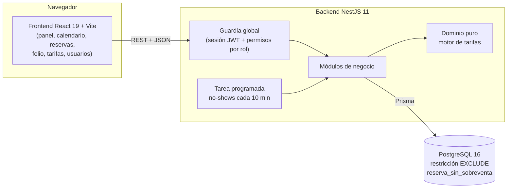
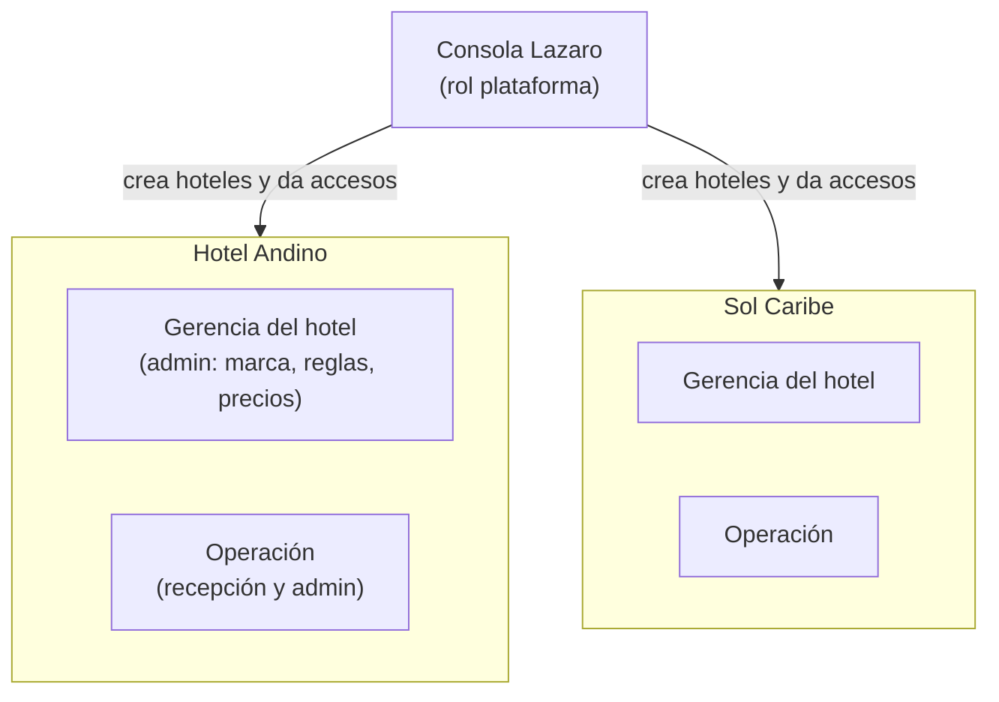
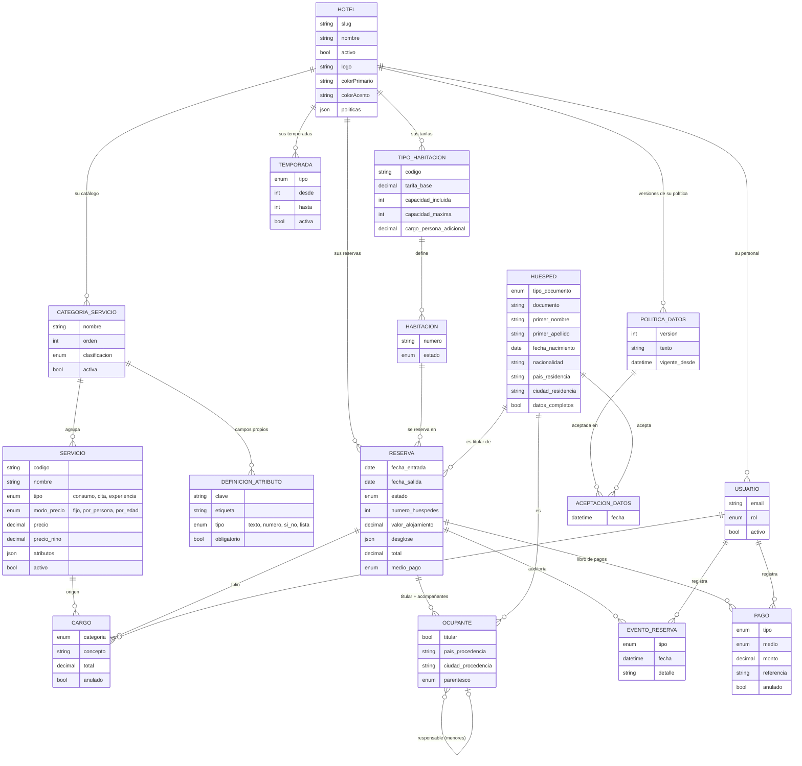
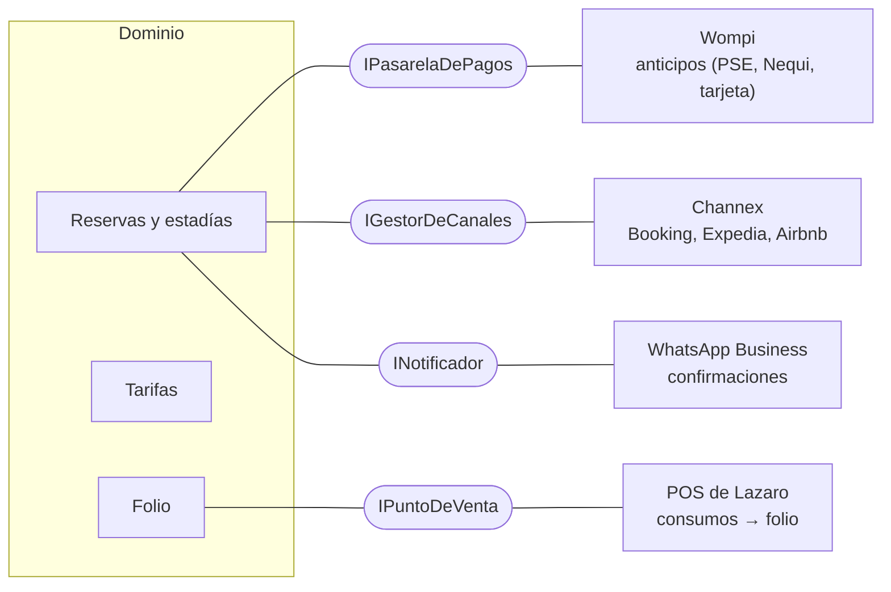

# Arquitectura — Módulo hotelero para Lazaro Software

## 1. El problema y la propuesta

Lazaro Software maneja hoy los hoteles con su modelo de restaurantes: **una
habitación es una mesa**. Una mesa se ocupa y se libera en el momento; una
habitación se **compromete a futuro por un rango de fechas**, cambia de precio
según la fecha y acumula consumos durante días. Este MVP es un **módulo
hotelero propio** que resuelve eso: reservas por fechas sin sobreventa,
tarifas por temporada, estadías con folio de consumos y operación diaria de
recepción.

Es un prototipo independiente (stack propio); si se integra a Lazaro (.NET),
sería vía su API HTTP.

## 2. Vista general

- **Frontend**: SPA en React. No tiene reglas de negocio propias: muestra lo
  que calcula el backend (precios, penalidades, ocupación) y oculta acciones
  según los permisos, pero **la protección real está en el backend**.
- **Backend**: API REST en NestJS con módulos por área del negocio. Toda
  petición pasa por una guardia global (seguro por defecto: solo el login es
  público). Documentación interactiva en `/docs` (Swagger).
- **Base de datos**: PostgreSQL, accedida con Prisma. Es obligatoria: la
  garantía contra la sobreventa es una restricción de PostgreSQL.

## 3. Módulos del backend

| Módulo             | Responsabilidad                                                                                                                                                    |
| ------------------ | ------------------------------------------------------------------------------------------------------------------------------------------------------------------ |
| `auth`             | Login, sesión JWT (8 h), guardia global, permisos por rol, límite de intentos de login                                                                             |
| `usuarios`         | Gestión de usuarios del hotel (crear, rol, desactivar, restablecer contraseña)                                                                                     |
| `habitaciones`     | Habitaciones, disponibilidad con precio, estados (limpieza, fuera de servicio); rango, importación y cambios en lote (todo o nada)                                 |
| `importacion`      | **Puro**: encabezados normalizados, conversión de celdas e informe de una importación (el archivo se lee en el navegador; llegan filas en JSON)                    |
| `tarifas`          | **Dominio puro**: calendario de Colombia, temporadas y motor de tarificación; tipos de habitación                                                                  |
| `reservas`         | Ciclo de vida de la reserva: crear, check-in, check-out, cancelar, no-show; auditoría                                                                              |
| `folio`            | Consumos cargados a la habitación y liquidación del check-out                                                                                                      |
| `huespedes`        | Huésped único por documento, búsqueda e historial; reglas puras del registro legal (edad, datos que faltan, menores)                                               |
| `panel`            | Vistas de operación: panel "Hoy" y calendario de ocupación                                                                                                         |
| `hotel`            | El hotel del usuario: datos, marca, políticas y política de datos versionada (Gerencia); marca pública del ingreso; reloj                                          |
| `temporadas`       | Rangos de temporada alta y media propios de cada hotel                                                                                                             |
| `servicios`        | Catálogo de servicios de cada hotel (S-1): categorías propias con atributos validados, servicios con precio fijo, por persona o por edad (reemplaza a `productos`) |
| `reportes-legales` | Solo lectura: TRA y SIRE de un rango de fechas, en JSON o CSV (UTF-8 con BOM, `;`), y las estadías por completar; municipios DIVIPOLA del DANE en `huespedes/`     |
| `plataforma`       | Consola Lazaro: alta de hoteles, acceso de su personal, suspensión                                                                                                 |

Los endpoints piden **permisos**, no roles (`auth/permisos.ts`): cambiar qué
puede hacer un rol es editar una tabla, sin tocar los controladores.

### Multi-tenant: un hotel por cliente, una sola instalación

La plataforma se vende a muchos hoteles. Todos comparten la base de datos y
cada tabla operativa lleva `hotel_id`.

- **Tres niveles de acceso:**
  - _plataforma_: el equipo de Lazaro, sin hotel. Solo usa la Consola: no opera reservas.
  - _admin_: la Gerencia y la operación de su hotel.
  - _recepcionista_: solo la operación.
- **Aislamiento:**
  - La guardia global carga en cada petición el hotel del usuario y sus reglas ya resueltas (`ContextoHotel`: políticas y temporadas activas).
  - Los servicios lo reciben de forma explícita (`@HotelActual()`) y toda consulta filtra por `hotelId`.
  - Un id de otro hotel responde 404: no se revela que existe.
  - Un hotel suspendido no entra, ni con la sesión abierta.
- **Reglas por hotel:**
  - `PoliticasHotel` (JSON en el hotel, sobre los valores por defecto), temporadas (tabla `temporada`) y catálogo (`producto_consumo`).
  - El motor de tarifas sigue siendo dominio puro: recibe las reglas del hotel como parámetro.
- **Marca:**
  - Logo, colores, tipografías y eslogan.
  - El frontend genera con dos colores las escalas de su CSS (`logica/tema.ts`) y corrige los tonos sin contraste suficiente.
  - Cada hotel tiene su ingreso propio (`/?hotel=identificador`), que lee la marca de un endpoint público que solo devuelve lo visual.

## 4. Las invariantes y dónde se protegen

La pregunta que guía el diseño: _¿qué regla del negocio nunca se puede romper,
y qué la garantiza aunque dos personas actúen al mismo tiempo?_

| Invariante                                                                                                  | Dónde se protege                                                                                                                                                  | Cómo se prueba                                                                                                                 |
| ----------------------------------------------------------------------------------------------------------- | ----------------------------------------------------------------------------------------------------------------------------------------------------------------- | ------------------------------------------------------------------------------------------------------------------------------ |
| **No sobreventa**: una habitación no tiene dos reservas vigentes que se solapen                             | Restricción `EXCLUDE USING gist` en PostgreSQL (atómica); el servicio hace una verificación previa solo para responder un 409 claro                               | 10 reservas simultáneas → 1 gana. **Sin la restricción, las 10 se crean** (experimento hecho: la verificación previa no basta) |
| **La tarifa** depende de la temporada de cada noche, los adultos adicionales, la edad de los niños y el IVA | Motor de tarificación puro (`tarifas/`); el desglose se **congela** en la reserva                                                                                 | 36 pruebas unitarias sin base de datos (Pascua, 18 festivos de 2026, temporadas, IVA, niños por edad, salida anticipada)       |
| **Solo se cargan consumos con la estadía activa**                                                           | Folio: verificación del estado dentro de una transacción que **bloquea la fila de la reserva** (`SELECT … FOR UPDATE`)                                            | Cargos y check-out simultáneos: el total siempre cuadra. **Sin el bloqueo falla 4 de cada 5 veces**                            |
| **El check-out cierra y liquida el folio**                                                                  | Transacción única: total = alojamiento pactado + consumos vigentes, pagos finales, habitación a limpieza, evento de auditoría                                     | Pruebas de liquidación, anulaciones y rechazo de cargos posteriores                                                            |
| **El saldo siempre cuadra**                                                                                 | Se calcula del libro de pagos (nunca se guarda); registrar un pago y el check-out bloquean la misma fila de la reserva (`SELECT … FOR UPDATE`)                    | 10 abonos simultáneos con el check-out, 5 veces: o el abono entra antes y el check-out lo cuenta, o se rechaza                 |
| Solo se entrega una habitación lista                                                                        | Actualización condicionada en el check-in ("solo si está libre"): también evita dos check-in a la vez                                                             | Pruebas del ciclo libre → ocupada → en limpieza → libre                                                                        |
| Cada acción queda atribuida a una persona                                                                   | El evento de auditoría se escribe **en la misma transacción** que el cambio; un usuario con acciones no se puede borrar (FK `RESTRICT`)                           | Una acción rechazada no deja rastro; una exitosa siempre lo deja                                                               |
| Un huésped no se duplica                                                                                    | Índice único (tipo + número de documento normalizado); se inserta con `ON CONFLICT DO NOTHING`, que dentro de una transacción espera a la otra y no la aborta     | Dos reservas, o dos check-in, a la vez con el mismo huésped nuevo → un solo registro                                           |
| **Un solo titular por reserva**; una persona no se repite como ocupante                                     | Índice parcial único `ocupante_un_titular` (escrito a mano en la migración) y único `(reserva, huésped)`; el check-in crea todos los ocupantes en una transacción | Faltantes, menores o política sin aceptar → 400 y la reserva sigue confirmada, sin ocupantes                                   |
| **Un hotel nunca ve ni toca los datos de otro**                                                             | `hotel_id` en cada tabla; la guardia resuelve el hotel del usuario y cada consulta filtra por él; unicidad por hotel                                              | Pruebas de aislamiento sobre cada recurso: listar, ver, reservar, check-in, folio, tarifas, temporadas, catálogo, usuarios     |
| Lo pactado no cambia si el hotel cambia sus reglas                                                          | La reserva guarda su desglose, su límite de cancelación gratuita y sus noches de penalidad                                                                        | Cambiar IVA, multiplicadores o política de cancelación no altera las reservas existentes                                       |

## 5. Decisiones de diseño

- **PostgreSQL y no otro motor**: la restricción de exclusión sobre rangos de
  fechas es lo que hace imposible la sobreventa, incluso con muchas peticiones
  concurrentes. Que Node.js sea de un solo hilo no lo evita: dos peticiones se
  intercalan en cada `await`.
- **Precio congelado**: al reservar se guarda el desglose completo noche por
  noche (JSON). Si el hotel cambia sus tarifas, las reservas existentes
  conservan lo pactado y la penalidad usa el valor real de la primera noche.
- **Calendario calculado, no cargado**: la Pascua (algoritmo gregoriano) y los
  festivos con la Ley Emiliani se calculan para cualquier año; el hotel no
  tiene que mantener un calendario.
- **Reloj inyectable**: las reglas que dependen de la hora (cancelación
  gratuita 48 h, no-show, "hoy" en Colombia UTC-5) se prueban fijando la hora.
- **Arquitectura en capas de NestJS para el MVP**, con una excepción
  deliberada: el núcleo de tarifas (`calendario-colombia.ts`, `temporadas.ts`
  y `motor-tarificacion.ts`) es **dominio puro**: no importa NestJS ni Prisma
  y se prueba sin base de datos; el servicio y el controlador de la misma
  carpeta solo lo envuelven. Es el primer paso del refactor hexagonal previsto
  antes de las integraciones externas.
- **Anular en vez de borrar**: los consumos y los usuarios no se eliminan; se
  anulan o desactivan, para no perder la trazabilidad.

## 6. Modelo de datos (resumen)

## 7. Calidad

- **408 pruebas automáticas**: 353 del backend (de punta a punta contra un
  PostgreSQL real, incluidas las migraciones de datos de ocupantes, de adultos
  y niños, de pagos y del catálogo de servicios, los reportes legales, la concurrencia de los pagos y los
  anticipos, y unitarias del dominio de tarifas, temporadas, registro legal,
  CSV, DIVIPOLA, estado de cuenta, importación, atributos propios y precio de
  los servicios, y las operaciones en lote de habitaciones) y 55 del frontend (calendario, ocupación, fechas de temporada,
  tema de la marca, formulario de ocupantes del check-in, desglose, rangos de
  edad, municipios, pagos del check-out, lectura de archivos CSV y Excel y servicios).
- ESLint y Prettier compartidos. `npm audit` del frontend reporta una
  vulnerabilidad alta en `vite` (servidor de desarrollo, no en el build); se
  corrige al actualizar `vite`, pendiente. Las dependencias de importación
  (`papaparse`, `read-excel-file`) no tienen avisos; no se usa el paquete `xlsx`.
- Docker: la demo completa se levanta con un comando.

## 8. Hoja de ruta: integraciones detrás de puertos

Las integraciones externas **no entran al dominio**: el dominio define una
interfaz (puerto) y cada proveedor es un adaptador intercambiable.

Orden propuesto (de lo barato y aislado a lo que toca infraestructura externa):

1. **Refactor hexagonal**: extraer el resto del dominio como ya está el motor
   de tarifas.
2. **POS de Lazaro → folio**: el "cargar a la habitación" del restaurante
   llega automáticamente (hoy es manual).
3. **Reserva web pública + pagos (Wompi)**: el pago se confirma por webhook
   (idempotente, firma verificada), nunca por la respuesta del navegador.
4. **Channex (OTAs)** como capa anticorrupción y **WhatsApp** para
   confirmaciones.
5. Despliegue (DigitalOcean), observabilidad y facturación de la plataforma
   (planes por hotel). El modelo multi-hotel ya está construido.
