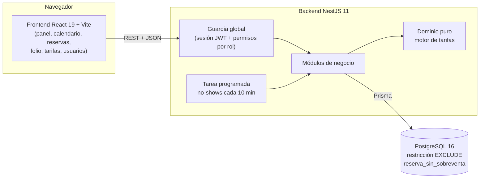
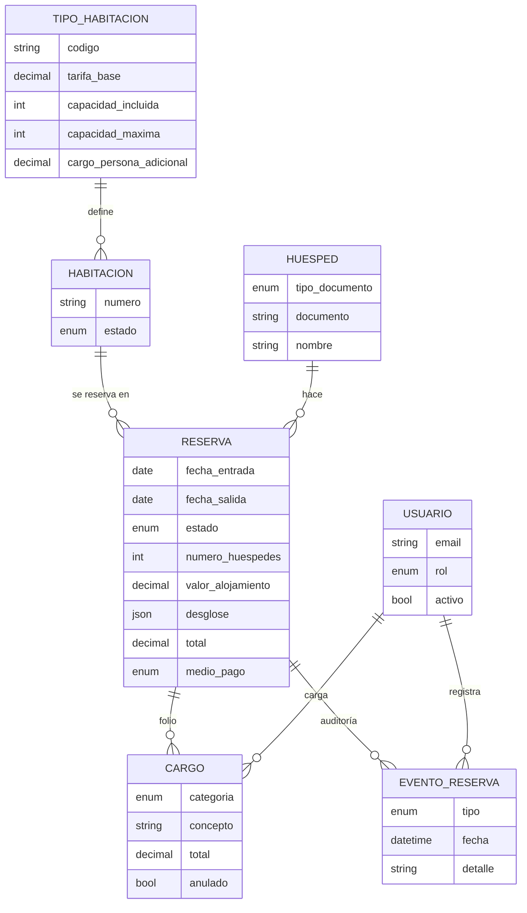

# Arquitectura — Módulo hotelero para Lazaro Software

## 1. El problema y la propuesta

Lazaro Software maneja hoy los hoteles con su modelo de restaurantes: **una
habitación es una mesa**. Una mesa se ocupa y se libera en el momento; una
habitación se **compromete a futuro por un rango de fechas**, cambia de precio
según la fecha y acumula consumos durante días. Este MVP es un **módulo
hotelero propio** que resuelve eso: reservas por fechas sin sobreventa,
tarifas por temporada, estadías con folio de consumos y operación diaria de
recepción.

Es un prototipo independiente (stack propio); si se integra a Lazaro (.NET),
sería vía su API HTTP.

## 2. Vista general

- **Frontend**: SPA en React. No tiene reglas de negocio propias: muestra lo
  que calcula el backend (precios, penalidades, ocupación) y oculta acciones
  según los permisos, pero **la protección real está en el backend**.
- **Backend**: API REST en NestJS con módulos por área del negocio. Toda
  petición pasa por una guardia global (seguro por defecto: solo el login es
  público). Documentación interactiva en `/docs` (Swagger).
- **Base de datos**: PostgreSQL, accedida con Prisma. Es obligatoria: la
  garantía contra la sobreventa es una restricción de PostgreSQL.

## 3. Módulos del backend

| Módulo         | Responsabilidad                                                                                   |
| -------------- | ------------------------------------------------------------------------------------------------- |
| `auth`         | Login, sesión JWT (8 h), guardia global, permisos por rol, límite de intentos de login            |
| `usuarios`     | Gestión de usuarios del hotel (crear, rol, desactivar, restablecer contraseña)                    |
| `habitaciones` | Habitaciones, disponibilidad con precio, estados (limpieza, fuera de servicio)                    |
| `tarifas`      | **Dominio puro**: calendario de Colombia, temporadas y motor de tarificación; tipos de habitación |
| `reservas`     | Ciclo de vida de la reserva: crear, check-in, check-out, cancelar, no-show; auditoría             |
| `folio`        | Consumos cargados a la habitación y liquidación del check-out                                     |
| `huespedes`    | Huésped único por documento, búsqueda e historial                                                 |
| `panel`        | Vistas de operación: panel "Hoy" y calendario de ocupación                                        |
| `hotel`        | Políticas del hotel (horarios, plazos, multiplicadores, IVA) y el reloj inyectable                |

Los endpoints piden **permisos**, no roles (`auth/permisos.ts`): cambiar qué
puede hacer un rol es editar una tabla, sin tocar los controladores.

## 4. Las invariantes y dónde se protegen

La pregunta que guía el diseño: _¿qué regla del negocio nunca se puede romper,
y qué la garantiza aunque dos personas actúen al mismo tiempo?_

| Invariante                                                                             | Dónde se protege                                                                                                                        | Cómo se prueba                                                                                                                 |
| -------------------------------------------------------------------------------------- | --------------------------------------------------------------------------------------------------------------------------------------- | ------------------------------------------------------------------------------------------------------------------------------ |
| **No sobreventa**: una habitación no tiene dos reservas vigentes que se solapen        | Restricción `EXCLUDE USING gist` en PostgreSQL (atómica); el servicio hace una verificación previa solo para responder un 409 claro     | 10 reservas simultáneas → 1 gana. **Sin la restricción, las 10 se crean** (experimento hecho: la verificación previa no basta) |
| **La tarifa** depende de la temporada de cada noche, las personas adicionales y el IVA | Motor de tarificación puro (`tarifas/`); el desglose se **congela** en la reserva                                                       | 23 pruebas unitarias sin base de datos (Pascua, 18 festivos de 2026, temporadas, IVA)                                          |
| **Solo se cargan consumos con la estadía activa**                                      | Folio: verificación del estado dentro de una transacción que **bloquea la fila de la reserva** (`SELECT … FOR UPDATE`)                  | Cargos y check-out simultáneos: el total siempre cuadra. **Sin el bloqueo falla 4 de cada 5 veces**                            |
| **El check-out cierra y liquida el folio**                                             | Transacción única: total = alojamiento pactado + consumos vigentes, medio de pago, habitación a limpieza, evento de auditoría           | Pruebas de liquidación, anulaciones y rechazo de cargos posteriores                                                            |
| Solo se entrega una habitación lista                                                   | Actualización condicionada en el check-in ("solo si está libre"): también evita dos check-in a la vez                                   | Pruebas del ciclo libre → ocupada → en limpieza → libre                                                                        |
| Cada acción queda atribuida a una persona                                              | El evento de auditoría se escribe **en la misma transacción** que el cambio; un usuario con acciones no se puede borrar (FK `RESTRICT`) | Una acción rechazada no deja rastro; una exitosa siempre lo deja                                                               |
| Un huésped no se duplica                                                               | Índice único (tipo + número de documento normalizado) y manejo de la carrera de dos reservas simultáneas                                | Dos reservas a la vez del mismo huésped nuevo → un solo registro                                                               |

## 5. Decisiones de diseño

- **PostgreSQL y no otro motor**: la restricción de exclusión sobre rangos de
  fechas es lo que hace imposible la sobreventa, incluso con muchas peticiones
  concurrentes. Que Node.js sea de un solo hilo no lo evita: dos peticiones se
  intercalan en cada `await`.
- **Precio congelado**: al reservar se guarda el desglose completo noche por
  noche (JSON). Si el hotel cambia sus tarifas, las reservas existentes
  conservan lo pactado y la penalidad usa el valor real de la primera noche.
- **Calendario calculado, no cargado**: la Pascua (algoritmo gregoriano) y los
  festivos con la Ley Emiliani se calculan para cualquier año; el hotel no
  tiene que mantener un calendario.
- **Reloj inyectable**: las reglas que dependen de la hora (cancelación
  gratuita 48 h, no-show, "hoy" en Colombia UTC-5) se prueban fijando la hora.
- **Arquitectura en capas de NestJS para el MVP**, con una excepción
  deliberada: el núcleo de tarifas (`calendario-colombia.ts`, `temporadas.ts`
  y `motor-tarificacion.ts`) es **dominio puro**: no importa NestJS ni Prisma
  y se prueba sin base de datos; el servicio y el controlador de la misma
  carpeta solo lo envuelven. Es el primer paso del refactor hexagonal previsto
  antes de las integraciones externas.
- **Anular en vez de borrar**: los consumos y los usuarios no se eliminan; se
  anulan o desactivan, para no perder la trazabilidad.

## 6. Modelo de datos (resumen)

## 7. Calidad

- **180 pruebas automáticas**: 172 del backend (149 de punta a punta contra un
  PostgreSQL real + 23 unitarias del dominio de tarifas) y 8 del frontend.
- ESLint y Prettier compartidos; `npm audit` sin vulnerabilidades altas ni
  críticas (ver README).
- Docker: la demo completa se levanta con un comando.

## 8. Hoja de ruta: integraciones detrás de puertos

Las integraciones externas **no entran al dominio**: el dominio define una
interfaz (puerto) y cada proveedor es un adaptador intercambiable.

Orden propuesto (de lo barato y aislado a lo que toca infraestructura externa):

1. **Refactor hexagonal**: extraer el resto del dominio como ya está el motor
   de tarifas.
2. **POS de Lazaro → folio**: el "cargar a la habitación" del restaurante
   llega automáticamente (hoy es manual).
3. **Reserva web pública + pagos (Wompi)**: el pago se confirma por webhook
   (idempotente, firma verificada), nunca por la respuesta del navegador.
4. **Channex (OTAs)** como capa anticorrupción y **WhatsApp** para
   confirmaciones.
5. Despliegue (DigitalOcean), observabilidad y modelo multi-hotel.
