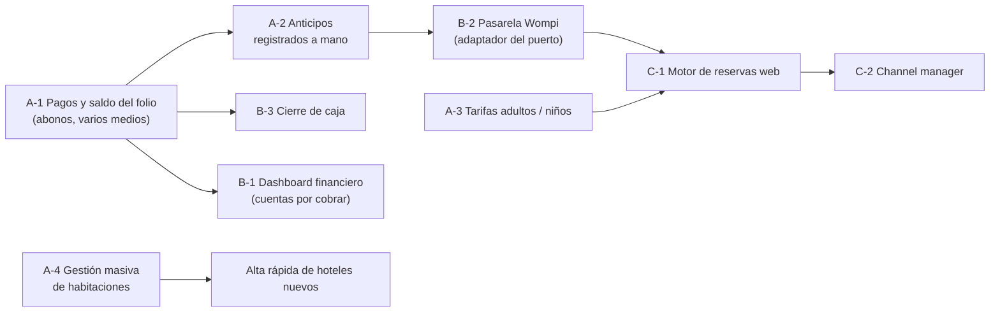
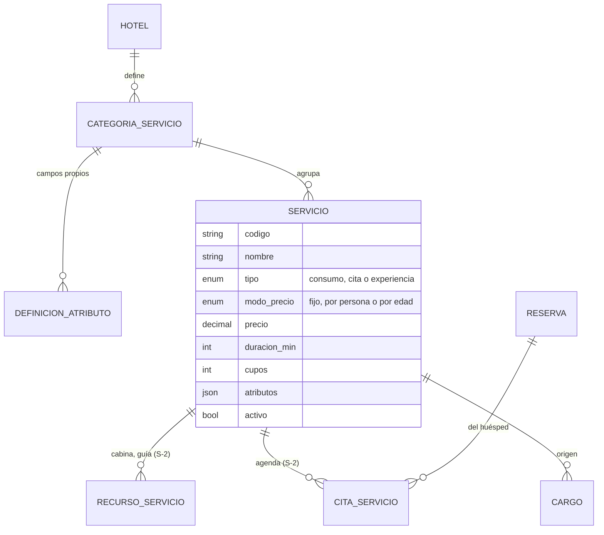

# Backlog priorizado — Módulo hotelero (Lazaro Software)

> **Base:** comparación del MVP actual (ver [Arquitectura](ARQUITECTURA.md) y
> [Reglas de negocio](REGLAS_DE_NEGOCIO.md)) contra las funciones que el
> mercado considera estándar en un PMS (_Property Management System_, el
> software central de un hotel) para hoteles independientes.
> **Fecha:** 27 de octubre de 2026.
>
> **Supuestos explícitos** (no tenemos estos datos; cambian el orden si son
> distintos):
>
> - Cliente objetivo: hoteles pequeños y medianos de Colombia (10–80
>   habitaciones), vendidos por Lazaro como plataforma multi-hotel.
> - Equipo de 5 estudiantes con dedicación parcial. Esfuerzo en tallas:
>   **S** ≈ 1 semana, **M** ≈ 2–3 semanas, **L** ≈ 4+ semanas (para el equipo).
> - Lazaro ya tiene POS de restaurante, inventario de su restaurante y
>   facturación electrónica con un proveedor DIAN. **Hay que confirmarlo**: si
>   no los tiene, los ítems B-6, C-3 y C-6 suben de prioridad y de tamaño.

---

## 1. Qué tiene un PMS de mercado y qué tiene el MVP

✅ hecho · 🟡 parcial · ❌ no existe

| Área                             | Lo que el mercado da por sentado                                                                                                    | MVP hoy                                                                                                                    |
| -------------------------------- | ----------------------------------------------------------------------------------------------------------------------------------- | -------------------------------------------------------------------------------------------------------------------------- |
| Reservas y disponibilidad        | Reservar por fechas sin sobreventa, calendario de ocupación                                                                         | ✅ Con garantía en base de datos (restricción `EXCLUDE`)                                                                   |
| Modificar reservas               | Cambiar fechas o habitación, mover en el calendario (arrastrar y soltar)                                                            | ❌ Hoy se cancela y se crea otra (R7)                                                                                      |
| Tarifas                          | Tarifa por tipo, temporadas, personas adicionales                                                                                   | ✅ Motor puro con desglose congelado                                                                                       |
| Tarifas por edad                 | Precio distinto para adultos y niños por rango de edad; niños gratis hasta cierta edad                                              | ❌ Solo `numeroHuespedes`, sin edades                                                                                      |
| Planes tarifarios                | "Solo alojamiento" / "con desayuno", estadía mínima por fecha, tarifa de fin de semana                                              | ❌                                                                                                                         |
| Check-in / check-out             | Registro del huésped, entrega y liberación de habitación                                                                            | ✅                                                                                                                         |
| Folio (cuenta de la estadía)     | Cargos, **pagos parciales, abonos, saldo**, varios medios de pago, dividir la cuenta                                                | 🟡 Cargos sí; un solo pago completo al salir; no hay saldo ni abonos                                                       |
| Anticipos y depósitos            | Registrar el anticipo, descontarlo al salir, retenerlo o devolverlo al cancelar                                                     | ❌ La penalidad se registra como monto a cobrar                                                                            |
| Pasarela de pagos                | Cobrar anticipos con link de pago o en el motor de reservas; confirmación por webhook                                               | ❌ Diseñado detrás de un puerto (Wompi), no construido                                                                     |
| Caja                             | Cierre de turno por usuario y medio de pago                                                                                         | ❌                                                                                                                         |
| Housekeeping                     | Estados de la habitación, tareas asignadas a camareras, incidencias de mantenimiento                                                | 🟡 Estados sí (libre, ocupada, en limpieza, fuera de servicio); sin tareas ni asignación                                   |
| Gestión masiva                   | Crear habitaciones en lote, cambiar estados en lote, importar desde Excel                                                           | ❌ Una por una                                                                                                             |
| Inventario de consumibles        | Stock de minibar y amenities, mínimo para reponer, descuento automático al consumir                                                 | ❌ Hay catálogo de consumos, sin stock                                                                                     |
| Dashboard y reportes             | Ocupación, **ADR, RevPAR**, pickup, pronóstico de ocupación, cancelaciones, cuentas por cobrar                                      | 🟡 Panel "Hoy": ocupación de hoy, llegadas, salidas, ingresos del mes                                                      |
| Cumplimiento legal (Colombia)    | **TRA** (MinCIT, todos los huéspedes) y **SIRE** (Migración, extranjeros)                                                           | 🟡 Se capturan los datos y hay "Registro hotelero" del día; no se exporta ni se envía                                      |
| Datos legales del huésped        | Nombres y apellidos separados, fecha de nacimiento, residencia, **cada acompañante**, menores con parentesco, autorización de datos | 🟡 Un nombre, documento, nacionalidad y procedencia del titular; sin acompañantes ([detalle](REGISTRO_LEGAL_HUESPEDES.md)) |
| Servicios y experiencias         | Catálogo de spa, tours y experiencias con agenda, cupos, fotos y precio por persona; carga masiva                                   | 🟡 Catálogo de consumos simple (nombre, categoría fija, precio)                                                            |
| Facturación electrónica          | Factura DIAN al cerrar la estadía                                                                                                   | ❌ La emitiría Lazaro con su proveedor (supuesto)                                                                          |
| Motor de reservas web            | El huésped reserva y paga en la web del hotel, sin comisión                                                                         | ❌                                                                                                                         |
| Channel manager                  | Sincroniza disponibilidad y precios con Booking, Expedia y Airbnb                                                                   | ❌ Diseñado detrás de un puerto (Channex)                                                                                  |
| Comunicación con el huésped      | Confirmación automática, recordatorio antes de llegar, mensaje después de salir                                                     | ❌ Diseñado detrás de un puerto (WhatsApp)                                                                                 |
| Grupos y empresas                | Bloqueos de habitaciones para grupos, cuenta empresa que paga a crédito                                                             | ❌                                                                                                                         |
| Usuarios, auditoría, multi-hotel | Roles, trazabilidad, aislamiento entre clientes                                                                                     | ✅ Más sólido que muchos productos del segmento                                                                            |

**Lectura:** el núcleo (inventario sin sobreventa, tarifas, estadía, auditoría,
multi-hotel) está bien resuelto. La brecha grande está en el **dinero**: hoy
el sistema calcula lo que se debe, pero no lleva lo que se ha pagado. Por eso
los anticipos, la pasarela y los saldos dependen de una misma base, que hay
que construir primero.

---

## 2. La decisión que ordena el backlog

**Trade-off:** construir primero un "libro de pagos" del folio (sin pasarela)
retrasa una funcionalidad visible, la pasarela, pero evita rehacer el check-out
dos veces.

Hoy la reserva guarda un único `medioPago` y un `total`. Un anticipo, un pago
parcial, un pago con Wompi y un reembolso son todos **movimientos de dinero
sobre el folio**. Si la pasarela se construye antes, cada medio de pago termina
con su propia lógica de saldo. El orden recomendado es:

La pasarela es un **adaptador** del puerto `IPasarelaDePagos` que ya está
previsto en la arquitectura. Lo único que hace es crear movimientos `pago` en
el libro cuando llega el webhook. Así, el dominio no cambia al sumar otro
proveedor.

---

## 3. Backlog

Prioridad: **P0** = siguiente incremento, bloquea vender o usar el sistema a
diario · **P1** = necesario para competir · **P2** = diferenciador o depende de
terceros · **P3** = más adelante.

Los ítems marcados con ⭐ son los que pidió el equipo.

### P0 — Siguiente incremento

| ID  | Ítem                                                                                                                                                                                                                                                                                                                                                                                                                                                                                          | Por qué                                                                                                                                                              | Esfuerzo    | Nota de arquitectura                                                                                                                                                                                                                                                                       |
| --- | --------------------------------------------------------------------------------------------------------------------------------------------------------------------------------------------------------------------------------------------------------------------------------------------------------------------------------------------------------------------------------------------------------------------------------------------------------------------------------------------- | -------------------------------------------------------------------------------------------------------------------------------------------------------------------- | ----------- | ------------------------------------------------------------------------------------------------------------------------------------------------------------------------------------------------------------------------------------------------------------------------------------------ |
| A-1 | ⭐ **Consumos y saldos: pagos del folio.** Registrar abonos y pagos parciales en cualquier momento de la estadía, con varios medios de pago; mostrar el saldo pendiente; el check-out exige saldo 0 (o lo deja como cuenta por cobrar, con permiso de admin).                                                                                                                                                                                                                                 | Es la base de todo lo que mueve dinero. Hoy el check-out exige un solo pago completo (R23), y en la vida real el huésped abona durante la estadía.                   | M           | Nueva tabla `pago` (tipo: `anticipo`, `abono`, `reembolso`; medio; monto; usuario; `anulado`). Saldo = cargos vigentes + alojamiento − pagos vigentes, **siempre calculado, nunca guardado**. Usar el mismo bloqueo `FOR UPDATE` que ya protegen los cargos. Se anula, no se borra.        |
| A-2 | ⭐ **Anticipos.** Registrar el anticipo de una reserva confirmada (efectivo, transferencia o tarjeta en sitio), con el porcentaje sugerido de la política del hotel; descontarlo al salir; al cancelar, aplicar la penalidad contra el anticipo y calcular lo que se devuelve.                                                                                                                                                                                                                | Los hoteles piden anticipo para no perder la habitación por reservas falsas (R28). Sin esto, las penalidades son solo "monto a cobrar".                              | S (con A-1) | Un movimiento `anticipo` en el libro de A-1. El % por defecto va en `PoliticasHotel` y queda pactado en la reserva (igual que la cancelación, R40).                                                                                                                                        |
| A-3 | ⭐ **Tarifas diferenciadas para adultos y niños.** La reserva registra adultos y niños (con su edad). El hotel define los rangos (por ejemplo: 0–4 gratis, 5–11 con tarifa de niño, 12+ como adulto) y el cargo por niño adicional. Los niños cuentan para la capacidad máxima.                                                                                                                                                                                                               | Es estándar en el turismo familiar colombiano y hoy se cobra igual a un niño que a un adulto.                                                                        | M           | Cambio en el **dominio puro** del motor de tarifas (barato de probar sin base de datos). La edad de cada ocupante sale de D-1; en la reserva sin check-in, se declara la edad. Las reservas antiguas se migran como adultos. El desglose congelado agrega la línea "niños".                |
| A-4 | ⭐ **Gestión masiva de habitaciones.** Crear un rango ("101 a 120, tipo doble, piso 1"); seleccionar varias habitaciones y cambiar su estado (lista, fuera de servicio) o su tipo; importar desde CSV o Excel.                                                                                                                                                                                                                                                                                | Dar de alta un hotel de 60 habitaciones una por una es la primera fricción del cliente nuevo, y la plataforma se vende a muchos hoteles.                             | S–M         | Un endpoint de lote **en una sola transacción: todo o nada**, con un informe de cuáles fallan y por qué. Las reglas de cada habitación no cambian: sacar de servicio una habitación con reservas futuras sigue avisando, ahora agrupado.                                                   |
| A-5 | **Modificar una reserva.** Cambiar fechas, habitación o número de huéspedes, con precio recalculado (o mantenido si lo decide el admin), y mover reservas en el calendario.                                                                                                                                                                                                                                                                                                                   | Los análisis de mercado lo tratan como función básica. Hoy, cancelar y recrear pierde la trazabilidad y puede aplicar una penalidad por error.                       | M           | Se apoya en la restricción `EXCLUDE`: el cambio es un `UPDATE` que la base rechaza si se solapa. Agregar el evento de auditoría `modificada` con el antes y el después.                                                                                                                    |
| D-1 | 🟡 **Backend hecho (plan 01, 27 de octubre de 2026); faltan las pantallas (plan 02).** ⚖️ **Datos legales del huésped y acompañantes.** Cada ocupante de la reserva con sus datos: nombres y apellidos separados, fecha de nacimiento, país y ciudad de residencia y de procedencia. Menores: documento, parentesco con el adulto y permiso de los padres verificado. Autorización de tratamiento de datos (Ley 1581). Detalle en [Registro legal de huéspedes](REGISTRO_LEGAL_HUESPEDES.md). | Lo pidió el Ing. Lazaro. Hoy la TRA no se puede cumplir: no se registran los acompañantes. El SIRE pide la fecha de nacimiento, y las multas van de 105 a 2.631 UVT. | M–L         | Nueva entidad `Ocupante` (reserva ↔ huésped): lo de la persona va en `Huesped`; lo del viaje, en `Ocupante`. **Se hace junto con A-3**: las edades salen de la fecha de nacimiento, y así se migra el modelo una sola vez. Lo legal no se configura; cada hotel solo puede agregar campos. |
| A-6 | ⚖️ **Exportar TRA y SIRE.** Generar el archivo o reporte con los campos de la Tarjeta de Registro de Alojamiento (MinCIT) y del SIRE (Migración, extranjeros) a partir de los datos de D-1.                                                                                                                                                                                                                                                                                                   | Es una obligación legal (Ley 2068 de 2020). Sin esto, el hotel tiene que copiar los datos a mano. Envío automático: ver C-4.                                         | S           | Solo lectura sobre el modelo de D-1. El check-in avisa si falta un dato legal. Confirmar los campos vigentes con la fuente oficial antes de construirlo.                                                                                                                                   |

### P1 — Necesario para competir

| ID  | Ítem                                                                                                                                                                                                                                                                                                                                                                                                                                                                                | Por qué                                                                                                                                                                  | Esfuerzo              | Nota de arquitectura                                                                                                                                                                                                                                                                |
| --- | ----------------------------------------------------------------------------------------------------------------------------------------------------------------------------------------------------------------------------------------------------------------------------------------------------------------------------------------------------------------------------------------------------------------------------------------------------------------------------------- | ------------------------------------------------------------------------------------------------------------------------------------------------------------------------ | --------------------- | ----------------------------------------------------------------------------------------------------------------------------------------------------------------------------------------------------------------------------------------------------------------------------------- |
| S-1 | ⭐ **Catálogo de servicios y experiencias** (spa, tours, experiencias, paquetes, además de los consumos actuales): categorías creadas por el hotel, descripción, fotos, duración, precio fijo / por persona / adulto y niño, impuestos, días y horarios en que se ofrece, activo o inactivo. Alta **manual** y **carga masiva** desde CSV o Excel con plantilla, vista previa de errores y actualización por código.                                                                | Los servicios adicionales son ingreso extra por cada huésped que ya llegó. Cada hotel ofrece cosas distintas, así que necesita personalizarlos. Ver el diseño más abajo. | M                     | Evoluciona `ProductoConsumo`: las categorías pasan de enum a tabla del hotel, más un **tipo** (consumo, servicio con cita, experiencia con cupos) y **atributos propios** del hotel validados. El cargo sigue copiando concepto y precio (R5). Carga masiva: todo o nada, como A-4. |
| S-2 | **Agenda de servicios y experiencias.** Reservar una cita de spa (cabina o terapeuta, hora) o un cupo en una experiencia (salida con N cupos); el cargo pasa al folio al prestarse, o se cobra por adelantado con A-1. Vista del día por recurso.                                                                                                                                                                                                                                   | Sin agenda, el spa se maneja en un cuaderno y se cruzan las citas.                                                                                                       | M–L                   | **Reutiliza la idea de la no-sobreventa**: un recurso (cabina, terapeuta) no tiene dos citas que se solapen, garantizado con una restricción `EXCLUDE` sobre rangos de hora. Los cupos de una salida se controlan con un conteo bajo bloqueo (`FOR UPDATE`).                        |
| B-1 | ⭐ **Mejorar el dashboard.** (1) **ADR** (tarifa media por noche vendida) y **RevPAR** (ingreso por habitación disponible) del mes, comparados con el mes anterior; (2) **pronóstico de ocupación** de los próximos 7 y 30 días; (3) **pickup**: reservas creadas en los últimos 7 días; (4) cancelaciones y no-shows; (5) **cuentas por cobrar** (saldos de A-1); (6) selector de período. Una vista para recepción (operación del día) y otra para gerencia (dinero y tendencia). | Son los indicadores estándar de la industria. El panel de hoy responde "¿qué pasa hoy?", pero no "¿cómo va el negocio?".                                                 | M                     | Consultas agregadas sobre las tablas actuales; **no hace falta un almacén de datos** con este volumen. Las cifras de alojamiento van **sin IVA ni consumos** (sale del desglose congelado), y lo cancelado no cuenta como ocupado. Mostrar la hora a la que corresponden los datos. |
| B-2 | ⭐ **Pasarela de pagos (Wompi).** Link de pago para cobrar el anticipo a distancia (lo envía recepción por WhatsApp o correo); confirmación por webhook; reembolsos.                                                                                                                                                                                                                                                                                                                | Cobrar anticipos sin que el huésped esté en el hotel. Es requisito del motor web (C-1).                                                                                  | M                     | Adaptador del puerto `IPasarelaDePagos`. Webhook **idempotente** (la misma notificación dos veces = un solo pago) y **con la firma verificada**. El pago existe solo cuando llega el webhook (R29). Llaves de la pasarela por hotel, cifradas.                                      |
| B-3 | **Cierre de caja por turno.** Totales por medio de pago y por usuario del turno, cuadre contra el efectivo contado.                                                                                                                                                                                                                                                                                                                                                                 | Es como el hotel controla el dinero cada día. Se apoya en A-1.                                                                                                           | S                     | Reporte sobre la tabla `pago`.                                                                                                                                                                                                                                                      |
| B-4 | **Housekeeping con tareas.** Asignar habitaciones a camareras, una vista móvil simple para marcar "lista", y reportar incidencias de mantenimiento (que pueden sacar la habitación de servicio).                                                                                                                                                                                                                                                                                    | Hoy recepción marca la habitación lista; en un hotel de más de 20 habitaciones eso lo hace la camarera.                                                                  | M                     | Nuevo rol `housekeeping` en la tabla de permisos (sin tocar los controladores). Vista responsive, no una app nativa.                                                                                                                                                                |
| B-5 | **Cuenta empresa y dividir el folio.** Que una empresa pague el alojamiento y el huésped sus consumos; facturar a la razón social.                                                                                                                                                                                                                                                                                                                                                  | Es común en el turismo corporativo de ciudades como Bogotá o Medellín.                                                                                                   | M                     | Destinatario por cargo dentro del folio. Requiere A-1.                                                                                                                                                                                                                              |
| B-6 | **Facturación electrónica vía Lazaro.** Al cerrar la estadía, enviar la liquidación al proveedor DIAN de Lazaro.                                                                                                                                                                                                                                                                                                                                                                    | La factura es obligatoria. Lazaro ya la resuelve para restaurantes (supuesto).                                                                                           | M (depende de Lazaro) | Nuevo puerto `IFacturador`. El módulo **no emite**: entrega los datos. Hay que validar el IVA de extranjeros (R16) con un contador.                                                                                                                                                 |

### P2 — Diferenciadores o dependientes de terceros

| ID  | Ítem                                                                                                                                                                                                           | Por qué                                                                                                                        | Esfuerzo              | Nota de arquitectura                                                                                                                                                                                                                                      |
| --- | -------------------------------------------------------------------------------------------------------------------------------------------------------------------------------------------------------------- | ------------------------------------------------------------------------------------------------------------------------------ | --------------------- | --------------------------------------------------------------------------------------------------------------------------------------------------------------------------------------------------------------------------------------------------------- |
| C-1 | **Motor de reservas web** del hotel, con anticipo por Wompi y reserva `pendiente` que expira en 30 minutos (R28).                                                                                              | Reservas directas sin comisión de OTA (15–20 % en Booking, supuesto típico).                                                   | L                     | Endpoint público con límite de peticiones. La reserva `pendiente` también ocupa lugar en la restricción `EXCLUDE`. Una tarea libera las que expiran (como la de no-shows).                                                                                |
| C-2 | **Channel manager (Channex)**: Booking, Expedia y Airbnb.                                                                                                                                                      | El hotel pequeño vende la mayor parte por OTAs; sin esto, sobrevende **entre canales** aunque el MVP no sobrevenda por dentro. | L                     | Capa anticorrupción: el modelo de la OTA no entra al dominio. Es la integración más riesgosa: reintentos, conciliación y tarifas por canal.                                                                                                               |
| C-3 | ⭐ **Inventario de consumibles.** Stock por producto del catálogo, que se descuenta al cargar al folio; mínimos con alerta; entradas de compra; conteo físico. Amenities y lencería por piso.                  | Controla mermas en el minibar y evita quedarse sin amenities.                                                                  | M–L                   | **Primero, preguntarle a Lazaro si su software de restaurante ya tiene inventario**: lo correcto es integrarse (puerto `IInventario`), no construir un segundo inventario. Si no tiene, empezar solo con el minibar (stock = entradas − cargos vigentes). |
| C-4 | **Envío automático de TRA y SIRE**, si existe una API o un mecanismo oficial.                                                                                                                                  | Elimina el trabajo manual que deja A-6.                                                                                        | M                     | Depende de lo que ofrezcan MinCIT y Migración. Investigar antes de comprometerlo.                                                                                                                                                                         |
| C-5 | **Notificaciones (WhatsApp o correo):** confirmación, link de pago, recordatorio antes de llegar, encuesta después de salir.                                                                                   | Menos llamadas a recepción; refuerza B-2.                                                                                      | M                     | Puerto `INotificador`, envío asíncrono con reintento (aquí **sí** se justifica una cola sencilla en PostgreSQL, no un broker).                                                                                                                            |
| C-6 | **POS de Lazaro → folio**: el "cargar a la habitación" del restaurante llega solo.                                                                                                                             | Es la integración que hace única la propuesta de Lazaro.                                                                       | M (depende de Lazaro) | Puerto `IPuntoDeVenta`, idempotente por id de la venta. Respeta R21 (solo con la estadía activa).                                                                                                                                                         |
| C-7 | **Planes tarifarios y restricciones:** con o sin desayuno, estadía mínima por fecha (por ejemplo, 2 noches en puente), tarifa de fin de semana.                                                                | Sube el ingreso en las fechas pico.                                                                                            | M                     | Extensión del motor puro. Conviene hacerla antes de C-2, porque las OTAs trabajan con planes.                                                                                                                                                             |
| C-8 | **Grupos y bloqueos:** reservar N habitaciones para un evento, con fecha de liberación de las que no se usen.                                                                                                  | Bodas, eventos y empresas.                                                                                                     | M                     | Bloqueo como reserva de un huésped "grupo" por habitación; la restricción `EXCLUDE` lo cubre sin cambios.                                                                                                                                                 |
| S-3 | **Servicios avanzados:** paquetes (alojamiento + spa + tour a un precio), servicios para personas que no se alojan en el hotel, proveedores externos con comisión, publicar el catálogo en el motor web (C-1). | Más venta, pero solo cuando S-1 y S-2 se usen de verdad.                                                                       | M                     | Un paquete es un plan tarifario (C-7) con servicios incluidos: conviene diseñarlos juntos.                                                                                                                                                                |

### P3 — Más adelante

- Precios dinámicos (revenue management) según la ocupación y el pickup.
- Huéspedes frecuentes y fidelización (el historial por documento ya existe).
- Reportes para la cadena: varios hoteles de un mismo dueño.
- Integración con cerraduras electrónicas y reseñas.
- Despliegue productivo, observabilidad y planes de cobro de la plataforma (ya
  en la hoja de ruta de la arquitectura).

### Diseño: catálogo de servicios con alto nivel de personalización (S-1)

**Trade-off:** tener campos fijos y bien tipados más unos pocos atributos que
crea el hotel cuesta un poco de flexibilidad, pero evita construir un
"constructor de formularios" genérico, que es caro de probar y de mantener.

| Opción                                                             | Cómo es                                                                                                                                                                                                                       | A favor                                                                                                                       | En contra                                                                                                      | Costo |
| ------------------------------------------------------------------ | ----------------------------------------------------------------------------------------------------------------------------------------------------------------------------------------------------------------------------- | ----------------------------------------------------------------------------------------------------------------------------- | -------------------------------------------------------------------------------------------------------------- | ----- |
| A. Ampliar `ProductoConsumo`                                       | Más columnas fijas (descripción, duración, foto)                                                                                                                                                                              | Lo más simple; casi no hay migración                                                                                          | No alcanza para spa y tours (horarios, cupos, campos de cada hotel); la categoría sigue fija                   | S     |
| **B. Catálogo con tipos y atributos propios (recomendada)**        | Campos comunes tipados, más un **tipo** que activa campos extra (duración, recurso, cupos) y una lista de **atributos que define el hotel** (texto, número, sí/no, lista), guardados en JSON y validados contra su definición | Cubre spa, tours y paquetes; cada hotel lo personaliza sin código nuevo; las reglas del negocio siguen teniendo campos reales | Los atributos propios no sirven para hacer cálculos (solo se muestran o se filtran)                            | M     |
| C. Motor genérico (entidad-atributo-valor o formularios dinámicos) | Todo se define desde la pantalla                                                                                                                                                                                              | Máxima flexibilidad                                                                                                           | Consultas lentas y difíciles; validación y reportes muy caros; sobre-diseño para hoteles de 10–80 habitaciones | L+    |

La personalización (opción B) cubre: categorías y su orden, nombre y
descripción, fotos, campos propios por categoría (por ejemplo, "nivel de
dificultad", "incluye transporte", "restricciones de salud"), precio fijo, por
persona o por edad (reutiliza los rangos de A-3), impuesto, días y horarios,
visible o no para recepción y, más adelante, para la web.

**Carga masiva:** se descarga una plantilla por categoría, que ya trae las
columnas de los atributos propios. Al subirla, el sistema muestra la **vista
previa** con los errores por fila; al confirmar, aplica todo en **una
transacción**. Si el `codigo` ya existe, actualiza el servicio; si no, lo crea.
Nunca borra: lo que no viene en el archivo se deja como está, y para retirar un
servicio se marca inactivo.

---

## 4. Orden sugerido por incrementos

| Incremento | Contenido               | Resultado para la demo con el empresario                                                                           |
| ---------- | ----------------------- | ------------------------------------------------------------------------------------------------------------------ |
| 1          | D-1, A-3, A-6           | "El hotel cumple la TRA y el SIRE: registra a cada acompañante, cuida a los menores y cobra distinto a los niños." |
| 2          | A-1, A-2                | "El sistema lleva el dinero: anticipos, abonos y saldo."                                                           |
| 3          | A-4, S-1, A-5           | "Un hotel nuevo carga sus habitaciones y su spa desde Excel en minutos."                                           |
| 4          | B-1, S-2, B-3           | "La gerencia ve ADR, RevPAR y pronóstico; el spa tiene agenda; se cierra la caja."                                 |
| 5          | B-2, B-4, B-5, B-6, C-6 | Cobros por link y operación completa con las integraciones de Lazaro.                                              |
| 6+         | C-1, C-2, C-7, S-3 …    | Venta directa y por OTAs.                                                                                          |

## 5. Riesgos

- **Dinero mal calculado:** el saldo debe ser siempre derivado (nunca un
  campo que se actualiza) y probarse con concurrencia, como ya se probaron los
  cargos contra el check-out.
- **Webhooks:** duplicados, desordenados o falsificados. Idempotencia por id
  del proveedor y verificación de la firma son obligatorias, no mejoras.
- **Migración de `numeroHuespedes`:** las reservas existentes pasan a
  "N adultos". Sus desgloses congelados no se recalculan.
- **Datos personales:** pedir más datos sin la autorización de la Ley 1581
  aumenta el riesgo legal. La autorización (D-1) va en el mismo incremento que
  los campos nuevos, no después.
- **Dependencias externas** (Lazaro, DIAN, MinCIT, Channex): su plazo no lo
  controla el equipo. Por eso quedan después de lo que se construye solo.
- **Alcance:** el inventario y el channel manager son productos completos
  por sí solos. Construirlos sin validar la necesidad es el mayor riesgo de
  sobre-diseño.

## 6. Preguntas para el empresario

1. ¿Lazaro ya tiene **inventario** y **facturación electrónica**? (Define C-3 y B-6.)
2. ¿Qué porcentaje de anticipo piden hoy sus hoteles, y si lo devuelven al cancelar a tiempo?
3. ¿Hasta qué edad un niño no paga, y cuánto paga después? ¿Es igual en todos los hoteles?
4. ¿Cuántas habitaciones tiene el hotel típico? (Define cuánto pesa A-4.)
5. ¿Qué porcentaje de las ventas de sus hoteles llega por Booking o Airbnb? (Define cuándo hacer C-2.)

## Fuentes de la investigación

- Funciones esenciales de un PMS para hoteles independientes:
  [Amenitiz](https://amenitiz.com/en/blog/10-essential-pms-features-for-independent-hotels),
  [RoomRaccoon](https://roomraccoon.com/blog/your-key-to-success-property-management-system-for-small-hotels/),
  [innRoad](https://innroad.com/?p=11638),
  [Mews (tipos de software hotelero)](https://www.mews.com/es/blog/tipos-de-software-hoteleros).
- Folios, pagos divididos, depósitos y grupos:
  [Smart Order — módulos de un PMS](https://www.smartorder.ai/resources/blog/hotel-pms-application-modules/),
  [Ecosire — Hotel PMS Core](https://ecosire.com/apps/odoo/hotel-pms-core).
- Indicadores del dashboard (ADR, RevPAR, pickup):
  [Lean Hotel System](https://leanhotelsystem.com/en/?p=12387),
  [RateBoard](https://rateboard-servicedesk.atlassian.net/wiki/spaces/IPH/pages/924319782/Dashboard),
  [Smart Order — métricas semanales](https://www.smartorder.ai/resources/blog/hotel-pms-reporting-dashboard-weekly-metrics/).
- Inventario hotelero:
  [Cleverence](https://www.cleverence.com/articles/for-business/inventory-management-in-hotel-industry-4073/),
  [Lean Hotel System](https://leanhotelsystem.com/en/?p=7595).
- TRA y SIRE en Colombia:
  [MinCIT (2018)](https://www.mincit.gov.co/prensa/noticias/general/gobierno-facilita-la-formalizacion-de-alojamientos),
  [BU Consultores (2022)](https://www.bu.com.co/es/insights/noticias/boletin-real-time-23-de-noviembre-2022),
  [Chekin](https://chekin.com/legalidad/colombia/).
  Son fuentes secundarias: hay que confirmar los campos y plazos vigentes con el MinCIT y Migración.

> Casi todas las fuentes son de proveedores de software: sirven para saber
> **qué funciones se esperan**, no como cifras independientes.
