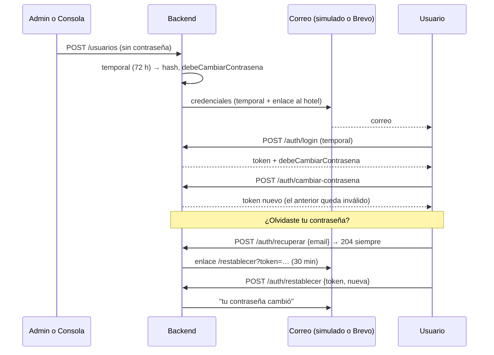

# Credenciales por correo (Brevo) y recuperación de la contraseña

Plan 18. Nadie escribe la contraseña de otra persona. Al crear un usuario (la
Consola Lazaro o el administrador del hotel), el sistema genera una
**contraseña temporal** y la envía a su correo. En el primer ingreso exige
cambiarla. Cada usuario puede recuperar su acceso solo, con "¿Olvidaste tu
contraseña?".

Hoy funciona de punta a punta con el **correo simulado**. Brevo está programado
y probado con un `fetch` falso; falta conectarlo con la API key (ver "Cuando
tengan la cuenta de Brevo").

## Cómo funciona

- **Puerto y adaptadores** (`backend/src/correo/`):
  - `puerto.ts` define `ICorreo.enviar({ para, nombre, asunto, html, texto })`;
  - `correo-simulado.adaptador.ts` no envía nada: guarda los correos en una
    bandeja en memoria (las pruebas la leen) y, fuera de producción, los imprime
    en la consola del backend;
  - `brevo.adaptador.ts` hace `POST https://api.brevo.com/v3/smtp/email` con la
    cabecera `api-key`, un tiempo de espera de 10 s, y lee el `messageId`.
- **Interruptor:** `CORREO_PROVEEDOR=simulado|brevo`, por defecto `simulado`.
  - En producción el simulado impide arrancar.
  - Con `brevo` son obligatorias `BREVO_API_KEY` y `CORREO_REMITENTE_EMAIL`.
- **Plantillas** (`plantillas.ts`, funciones puras): credenciales, credenciales
  reenviadas, recuperación y "tu contraseña cambió".
  - Escapan el HTML.
  - Llevan el nombre y el color del hotel, y el enlace a su ingreso
    (`URL_PUBLICA_APP/?hotel=<slug>`).
  - No llevan el logo: los clientes de correo bloquean las imágenes en base64.
- **Registro de envíos** (`correo_enviado`): plantilla, destinatario, estado
  (`enviado` o `fallido`), id del mensaje o error. **Nunca guarda el
  contenido**: ni la temporal ni el enlace quedan en la base.
- **Un correo que falla no deshace nada:** el usuario queda creado
  (`correoEnviado: false`) y se usa "Reenviar credenciales".
- **Cambio obligatorio (R71):** se hace cumplir en la guardia del servidor.
  Mientras `debeCambiarContrasena` está activo, todo lo que no sea
  `GET /auth/yo` o `POST /auth/cambiar-contrasena` responde
  `403 CAMBIO_CONTRASENA_REQUERIDO`.
- **Revocar sesiones (R74):** el token lleva `ver` (la versión de sesión del
  usuario). Cambiar o restablecer la contraseña, o reenviar las credenciales,
  la sube, y los tokens anteriores dan 401.
- **Recuperación (R73):**
  - el token es de 32 bytes aleatorios y se guarda solo su SHA-256;
  - vence en 30 minutos, y uno nuevo invalida los anteriores;
  - se marca usado con una actualización condicionada en la misma transacción
    del cambio (dos usos a la vez: uno gana);
  - `POST /auth/recuperar` siempre responde 204, exista o no el correo;
  - los dos endpoints tienen límite de intentos.

## Variables de entorno (`backend/.env`)

| Variable                    | Para qué                                                     |
| --------------------------- | ------------------------------------------------------------ |
| `CORREO_PROVEEDOR`          | `simulado` (por defecto) o `brevo`                           |
| `BREVO_API_KEY`             | La API key de Brevo (solo con `brevo`)                       |
| `CORREO_REMITENTE_EMAIL`    | El remitente, verificado en Brevo                            |
| `CORREO_REMITENTE_NOMBRE`   | El nombre del remitente (por defecto, "Lazaro Software")     |
| `CONTRASENA_TEMPORAL_HORAS` | Vigencia de la contraseña temporal (72)                      |
| `RECUPERACION_MINUTOS`      | Vigencia del enlace de recuperación (30)                     |
| `URL_PUBLICA_APP`           | El frontend: el enlace al ingreso y la página de restablecer |

En desarrollo, con el correo simulado, **la temporal y el enlace se leen en la
consola del backend**.

## Cuando tengan la cuenta de Brevo

1. Crear la cuenta en Brevo. El plan gratuito permite unos 300 correos al día:
   confirmar el límite vigente.
2. Verificar el remitente o, mejor, el dominio (SPF y DKIM), para que los
   correos no lleguen a spam.
3. Generar la API key en "SMTP y API" → "API keys".
4. En el entorno: `CORREO_PROVEEDOR=brevo`, `BREVO_API_KEY`,
   `CORREO_REMITENTE_EMAIL` y `CORREO_REMITENTE_NOMBRE`. Reiniciar el backend.
5. Crear un usuario de prueba con un correo del equipo. Comprobar que llega, y
   que el registro de envíos (`correo_enviado`) guarda el `idMensaje`.
6. Si algo difiere de la documentación, se corrige **solo** en
   `brevo.adaptador.ts` y su prueba (`correo.spec.ts`). Hay un punto por
   confirmar: la guía de Brevo sugiere un solo tipo de contenido por petición,
   y el adaptador envía `htmlContent` y `textContent` juntos. Si Brevo rechaza
   el envío, se quita `textContent`.

## Pruebas

- `backend/test/credenciales.e2e-spec.ts`:
  - crear desde el admin y desde la Consola, y el alta de un hotel con su
    equipo;
  - el 403 con la temporal y el token anterior rechazado tras el cambio;
  - la temporal vence a las 72 h y 1 minuto;
  - reenviar cierra la sesión;
  - un correo fallido;
  - el registro sin la temporal.
- `backend/test/recuperacion.e2e-spec.ts`:
  - un correo inexistente, inactivo o de un hotel suspendido no envía nada;
  - el enlace es de un solo uso (uso simultáneo), vence a los 30 minutos y uno
    nuevo invalida el anterior;
  - la política y el límite de intentos.
- `backend/src/correo/correo.spec.ts`: las plantillas, el adaptador de Brevo
  sin red y el interruptor.
- `backend/src/auth/contrasenas.spec.ts`: la temporal y la política.
- `frontend/src/logica/contrasena.test.ts`.
