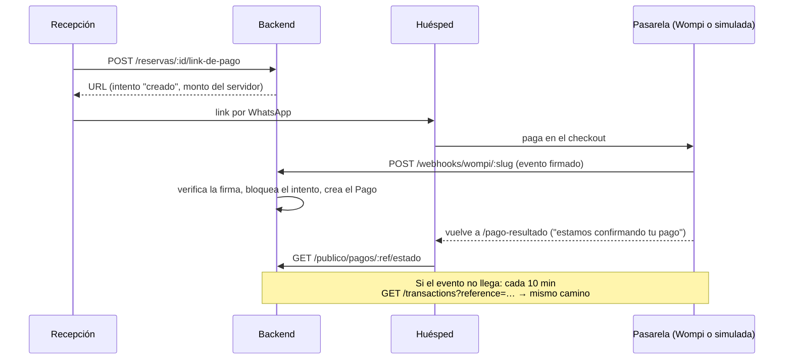

# Pagos en línea: pasarela simulada y Wompi

B-2 (plan 14). Recepción cobra el anticipo o el saldo de una reserva con un
**link de pago** que le envía al huésped (por WhatsApp o copiándolo). El pago
aparece en el folio **solo cuando la pasarela lo confirma** con un evento
firmado (R29), nunca porque el huésped vuelva a la página.

Hoy funciona de punta a punta con la **pasarela simulada**. Wompi está
programado y probado con respuestas grabadas; falta conectarlo con las llaves
de sandbox (ver "Cuando tengas las llaves").

## Cómo funciona

- **Puerto y adaptadores** (`backend/src/pagos-en-linea/`):
  - `puerto.ts` define `IPasarelaDePagos` (`crearLinkDePago`,
    `verificarEvento`, `consultarTransaccion` y `probarConexion`).
  - `pasarela-simulada.adaptador.ts` lleva a una página propia
    (`/pago-simulado`) con "Aprobar" y "Rechazar".
  - `wompi.adaptador.ts` usa el Web Checkout de Wompi.
  - El folio y las reservas no importan nada de Wompi.
- **Interruptor:** `PASARELA_PROVEEDOR=simulada|wompi` en `backend/.env` (por
  defecto `simulada`).
  - Con `wompi`, un hotel sin llaves no ve el botón "Generar link de pago":
    ve el aviso "Conecte su cuenta de Wompi en Gerencia → Pagos en línea".
  - **En producción la simulada está prohibida:** el backend no arranca con
    `NODE_ENV=production` y `PASARELA_PROVEEDOR=simulada`.
- **Web Checkout, no links de pago:** la API de links de pago de Wompi genera
  su propia referencia; el Web Checkout acepta la nuestra.
  - El link es `https://checkout.wompi.co/p/?public-key=…&currency=COP&amount-in-cents=…&reference=…&signature:integrity=…&redirect-url=…&expiration-time=…`.
  - Lleva la **firma de integridad**: SHA256 de referencia + centavos +
    moneda + expiración + secreto de integridad. Así nadie cambia el monto en
    el navegador.
- **El intento** (`intento_pago`) guarda:
  - la referencia (única) y el monto, que lo fija el servidor: por defecto, el
    anticipo sugerido pendiente o el saldo;
  - el estado: `creado`, `aprobado`, `rechazado` o `expirado`;
  - el id de la transacción del proveedor (único).
  - El link vence a las 48 horas.
- **El webhook** `POST /webhooks/wompi/:slug-del-hotel`:
  - es público, con un límite de 60 peticiones por minuto;
  - verifica la firma: SHA256 de los valores de `signature.properties` +
    `timestamp` + secreto de eventos;
  - si la firma es inválida responde 401; si la referencia es desconocida o de
    otro hotel, responde 200 y no hace nada.
  - En una transacción que **bloquea el intento** (`FOR UPDATE`):
    - si ya estaba aprobado, no hace nada (idempotencia);
    - con otro monto, no registra y deja una alerta;
    - si se aprueba, crea el `Pago` con el medio `pasarela` y la referencia de
      la transacción (anticipo antes del check-in, abono después).
- **El pago lo registra el sistema:** no entra a ninguna caja física, así que
  queda sin turno y no aparece en el aviso "sin turno" del cierre de caja.
- **La simulada pasa por el mismo camino:** su botón arma un evento firmado
  igual que Wompi (con `PASARELA_SIMULADA_SECRETO`) y lo entrega al mismo
  webhook, con la misma verificación. La página no crea pagos.
- **Reconciliación:** cada 10 minutos se consultan a la pasarela los intentos
  `creado` de más de 15 minutos, por si un webhook no llegó. Los vencidos sin
  pago quedan `expirado`.
- **Llaves por hotel** (Gerencia → Pagos en línea):
  - son la llave pública, la llave privada, el secreto de eventos y el secreto
    de integridad;
  - se guardan **cifradas** con AES-256-GCM y la llave maestra
    `CLAVE_CIFRADO_PAGOS`, y nunca se devuelven;
  - por ahora solo se aceptan las de pruebas: una de producción → 400.

## Variables de entorno (`backend/.env`)

| Variable                    | Para qué                                                                                                                         |
| --------------------------- | -------------------------------------------------------------------------------------------------------------------------------- |
| `PASARELA_PROVEEDOR`        | `simulada` (por defecto) o `wompi`                                                                                               |
| `CLAVE_CIFRADO_PAGOS`       | 32 bytes en base64: `node -e "console.log(require('crypto').randomBytes(32).toString('base64'))"`. Sin ella no se guardan llaves |
| `URL_PUBLICA_API`           | Dónde Wompi entrega los eventos (en local, la URL del túnel)                                                                     |
| `URL_PUBLICA_APP`           | El frontend: la página de retorno y la página simulada                                                                           |
| `PASARELA_SIMULADA_SECRETO` | Opcional: el secreto con que firma la simulada (no protege dinero real)                                                          |

## Cuando tengas las llaves

1. Crear la cuenta de comercio en Wompi y entrar al **ambiente de pruebas
   (sandbox)**.
2. En "Mi cuenta → Secretos para integración técnica", copiar las **4**
   llaves de pruebas:
   - la llave pública (`pub_test_…`);
   - la llave privada (`prv_test_…`);
   - el secreto de eventos (`test_events_…`);
   - el secreto de integridad (`test_integrity_…`).
3. Exponer el backend local con un túnel (por ejemplo, `cloudflared` o
   `ngrok`) y poner su URL en `URL_PUBLICA_API`. Poner `CLAVE_CIFRADO_PAGOS`
   si aún no está.
4. En `.env`: `PASARELA_PROVEEDOR=wompi`; reiniciar el backend.
5. En la app: **Gerencia → Pagos en línea** → pegar las llaves → **Probar
   conexión**. Consulta `GET /merchants/{llave pública}` y debe mostrar el
   nombre del comercio.
6. En el panel de Wompi, poner la **URL de eventos** que muestra la pantalla
   (`…/webhooks/wompi/<slug-del-hotel>`).
7. Generar un link desde una reserva y pagarlo con las tarjetas o los datos de
   prueba que publica Wompi; comprobar que el pago aparece en el folio en unos
   segundos.
8. Probar un pago rechazado. Luego apagar el túnel durante un pago, para
   comprobar que la reconciliación lo recupera en 10 a 15 minutos.
9. Si algo difiere de la documentación (nombres de campos, firma), se corrige
   **solo** en `wompi.adaptador.ts`, `firma-wompi.ts` y sus respuestas de
   ejemplo (`backend/test/fixtures/wompi/`), y se dejan las pruebas en verde.
   Hay dos puntos por confirmar con las llaves:
   - **La consulta de la reconciliación** (`GET /transactions?reference=…`
     con la llave privada) no aparece en la documentación pública consultada;
     si no existe así, se cambia solo `consultarTransaccion`.
   - **El checksum de ejemplo de la documentación de eventos** (`3476DDA5…`)
     no es el SHA256 de la cadena que la misma página muestra (da
     `5a18ec5e…`). La firma del Web Checkout sí coincide con su ejemplo. Con un
     evento real del sandbox se confirma el algoritmo.

## Pruebas

- `backend/test/pasarela.e2e-spec.ts` (con la simulada y eventos firmados):
  - un evento aprobado crea un pago y baja el saldo;
  - 5 eventos iguales a la vez crean 1 pago;
  - una firma inválida → 401; un monto distinto deja una alerta;
  - un evento rechazado no crea pago;
  - la reconciliación aprueba un pago cuyo webhook no llegó;
  - las llaves quedan cifradas y no salen por la API; una de producción → 400;
  - con Wompi y sin llaves → 409.
- `backend/src/pagos-en-linea/*.spec.ts`, sin red:
  - la firma y la integridad con los ejemplos oficiales;
  - la URL del checkout y los 5 estados de una transacción, con un `fetch`
    falso;
  - el cifrado y las llaves.
- Aislamiento: el webhook de un hotel no aprueba el intento de otro.
