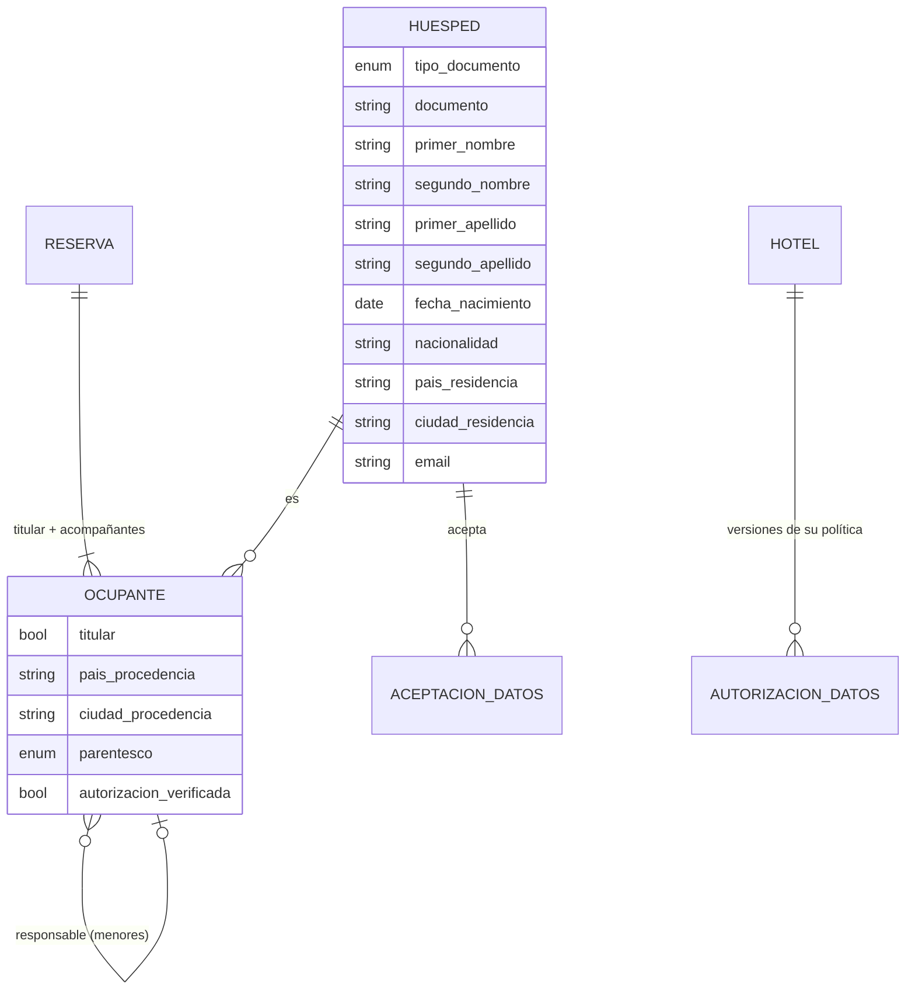

# Registro legal de huéspedes — qué pide la ley y qué falta en el MVP

> **Origen:** reunión con el Ing. Lazaro. Los datos que se le piden al huésped
> deben alcanzar para cumplir lo que los hoteles reportan a las autoridades.
> **Fecha:** 27 de octubre de 2026.
>
> ⚖️ **Esto es una investigación técnica, no asesoría legal.** Las fuentes
> oficiales consultadas (Migración Colombia, MinCIT) describen los datos en
> términos generales. Antes de construir los formularios hay que confirmar la
> lista exacta de campos en las plataformas TRA y SIRE (con un usuario de
> prueba del hotel) y con un asesor legal.

## 1. A quién le reporta un hotel en Colombia

| Obligación                                                        | Autoridad                                | A quién aplica                                           | Norma                                                                                                  | Qué tan confirmado está                                                                                                                                                                                                                                                                                   |
| ----------------------------------------------------------------- | ---------------------------------------- | -------------------------------------------------------- | ------------------------------------------------------------------------------------------------------ | --------------------------------------------------------------------------------------------------------------------------------------------------------------------------------------------------------------------------------------------------------------------------------------------------------- |
| **TRA**: Tarjeta de Registro de Alojamiento                       | MinCIT (plataforma `tramincit.gov.co`)   | Todos los huéspedes, el titular **y cada acompañante**   | Ley 2068 de 2020, art. 22                                                                              | Fuente oficial y manuales; la lista de campos sale de guías de terceros                                                                                                                                                                                                                                   |
| **SIRE**: reporte de extranjeros                                  | Migración Colombia                       | Solo los huéspedes extranjeros, **al entrar y al salir** | Decreto 1067 de 2015; Res. 2357 de 2020 (procedimiento); Res. 3770 de 2021 (multas de 105 a 2.631 UVT) | El ABC oficial del SIRE dice que el reporte debe ser "oportuno"; el plazo en horas no está confirmado                                                                                                                                                                                                     |
| **Menores de edad** (prevención de la explotación sexual, ESCNNA) | ICBF y Policía (denuncia)                | Todo huésped menor de 18 años                            | Ley 679 de 2001 y Ley 1336 de 2009                                                                     | Las políticas de los hoteles coinciden: documento del menor, parentesco con el adulto y, si viaja con un tercero, permiso de los padres                                                                                                                                                                   |
| **Protección de datos personales**                                | Superintendencia de Industria y Comercio | Todo dato que guarda el hotel                            | Ley 1581 de 2012 y Decreto 1377 de 2013                                                                | El texto de la ley es oficial: se necesita autorización del titular, y para los datos sensibles debe ser explícita                                                                                                                                                                                        |
| **Policía**                                                       | Policía Nacional                         | —                                                        | Ley 1801 de 2016 (Código de Seguridad y Convivencia)                                                   | ❓ **No encontré una obligación de reportar huéspedes a la Policía**: el código permite verificar el Registro Nacional de Turismo y entrar al establecimiento. **Hay que preguntarle a Lazaro qué formato o entidad mencionó**, porque puede ser una exigencia local (Policía de Turismo de un municipio) |

## 2. Brecha de datos

✅ ya se pide · 🟡 se pide incompleto · ❌ no se pide

### Huésped titular y acompañantes (TRA)

| Dato                                 | Dónde lo pide la ley   | MVP hoy                         | Cambio                                                                                                                                                   |
| ------------------------------------ | ---------------------- | ------------------------------- | -------------------------------------------------------------------------------------------------------------------------------------------------------- |
| Tipo y número de documento           | TRA, SIRE              | ✅ CC, CE, pasaporte, TI, PPT   | Agregar **registro civil** (menores de 7 años) y **PEP**. Verificar la lista de tipos que acepta cada plataforma                                         |
| Nombres y apellidos **por separado** | TRA, SIRE              | 🟡 Un solo campo `nombre`       | Separar en primer nombre, segundo nombre, primer apellido y segundo apellido                                                                             |
| **Fecha de nacimiento**              | SIRE; menores (ESCNNA) | ❌                              | Nueva. También da las edades de A-3 (tarifas de niños)                                                                                                   |
| Nacionalidad                         | SIRE                   | ✅ Código ISO                   | —                                                                                                                                                        |
| **País y ciudad de residencia**      | TRA                    | ❌                              | Nueva                                                                                                                                                    |
| País y ciudad de procedencia         | TRA                    | 🟡 `procedencia` es texto libre | Separar país y ciudad. Las ciudades de Colombia se eligen de una lista (códigos DIVIPOLA del DANE) para que el reporte no falle por errores de escritura |
| Motivo del viaje                     | TRA                    | ✅ 5 opciones                   | Comparar las opciones con la lista oficial de la TRA                                                                                                     |
| Habitación, entrada y salida         | TRA, SIRE              | ✅                              | —                                                                                                                                                        |
| **Acompañantes, uno por uno**        | TRA                    | ❌ Solo `numeroHuespedes`       | **El cambio más grande**: cada acompañante con sus propios datos (ver la sección 3)                                                                      |
| Valor pagado                         | TRA                    | ✅ Sale de la liquidación       | —                                                                                                                                                        |
| Tipo de alojamiento                  | TRA                    | ❌                              | Es un dato **del hotel**, no del huésped: va en Datos del hotel                                                                                          |

### Extranjeros (SIRE)

| Dato                                      | MVP hoy                                   | Cambio                                                                                                                                |
| ----------------------------------------- | ----------------------------------------- | ------------------------------------------------------------------------------------------------------------------------------------- |
| Movimiento de entrada o salida, con fecha | ✅ Se deriva del check-in y del check-out | —                                                                                                                                     |
| Fecha de nacimiento                       | ❌                                        | La misma de la tabla anterior                                                                                                         |
| Número y categoría de visa o permiso      | ❌                                        | ❓ El ABC oficial la menciona "en general". Hay que confirmar si aplica al reporte de alojamiento; si aplica, sería un campo opcional |
| Dirección en Colombia                     | —                                         | Para el alojamiento, es la del hotel                                                                                                  |

### Menores de edad

| Dato                                                  | MVP hoy                     | Cambio                                                                                      |
| ----------------------------------------------------- | --------------------------- | ------------------------------------------------------------------------------------------- |
| Documento del menor (registro civil o TI)             | 🟡 TI sí; registro civil no | Agregar el registro civil                                                                   |
| **Parentesco con el adulto responsable**              | ❌                          | Nuevo: padre o madre, otro familiar, tutor legal, tercero autorizado                        |
| **Permiso de los padres** cuando viaja con un tercero | ❌                          | Casilla "autorización verificada" con el usuario que la revisó; adjunto opcional (escaneo)  |
| Regla: un menor no se aloja solo                      | ❌                          | Regla en el check-in: si hay un menor, debe haber un adulto responsable en la misma reserva |

### Datos personales (Ley 1581)

| Dato                                      | MVP hoy | Cambio                                                                                                                               |
| ----------------------------------------- | ------- | ------------------------------------------------------------------------------------------------------------------------------------ |
| **Autorización del tratamiento de datos** | ❌      | Registrar quién aceptó, cuándo y qué versión de la política. Sin esto, guardar más datos aumenta el riesgo legal en vez de reducirlo |
| Política de tratamiento del hotel         | ❌      | Texto configurable por hotel en Gerencia                                                                                             |

### Contacto (no lo pide la ley de registro, pero sí la factura y la operación)

Correo electrónico (la factura electrónica se envía al correo), dirección de
residencia y contacto de emergencia (opcional).

## 3. Cambio en el modelo

**Trade-off:** pasar de "una reserva = un huésped" a "una reserva = varios
ocupantes" toca el check-in, el registro hotelero y la tarificación. Pero es
la única forma de cumplir la TRA, y es la misma información que necesita
A-3 (tarifas por edad). Hacer los dos cambios juntos evita migrar el modelo
dos veces.

- **`Huesped`** guarda lo que es de la persona (documento, nombres, fecha de
  nacimiento, residencia). **`Ocupante`** guarda lo que es de la estadía
  (procedencia, si es el titular, el parentesco). Una persona que vuelve no
  repite sus datos, pero su procedencia puede cambiar en cada viaje.
- Las reservas existentes se migran con un ocupante titular. El nombre
  completo actual se copia a `primer_nombre` y se marca "por completar".
- **Lo legal no se configura:** los campos obligatorios por ley se exigen
  siempre en el check-in, sea cual sea el hotel. Cada hotel puede **agregar**
  campos propios, pero no quitar los legales.
- **La reserva y el check-in piden cosas distintas:** para reservar bastan el
  nombre, el documento y el contacto. El resto se completa en el check-in,
  para no frenar la venta.
- **Exportación** (A-6): el reporte TRA y el reporte SIRE (solo los
  extranjeros, con un movimiento por check-in y otro por check-out) se generan
  a partir de este modelo. El check-in muestra un aviso si falta un dato
  legal.

## 4. Preguntas para el Ing. Lazaro

1. ¿Qué entidad o formato de la **Policía** mencionó? ¿Es un requisito de algún municipio en particular?
2. ¿Sus hoteles ya reportan la TRA y el SIRE? ¿A mano, o con qué software?
3. ¿Tienen un usuario de prueba en esas plataformas, para comparar los campos reales?
4. ¿Sus hoteles ya tienen una política de tratamiento de datos?

## Fuentes

- Migración Colombia — [ABC del SIRE](https://www.migracioncolombia.gov.co/fileadmin/user_upload/126422_abc-sire.pdf) (oficial).
- MinCIT — [Tarjeta de Registro Hotelero](https://siat.mincit.gov.co/noticias/tarjeta-de-registro-hotelero),
  [manual de usuarios conectados de la TRA](https://tramincit.gov.co/tarjeta/media/docs/Manual-Grupo-2-Usuarios-Directos-Conectados.pdf),
  [Decreto 2119 de 2018](https://www.mincit.gov.co/prensa/noticias/general/gobierno-facilita-la-formalizacion-de-alojamientos).
- Gobernación del Quindío — [presentación sobre la TRA](https://quindio.gov.co/home/docs/items/item_109/TURISMO/PRESENTACION_2_TRA.pdf).
- Campos de la TRA paso a paso: [Trabis](https://trabis.co/como-llenar-la-tarjeta-de-registro-de-alojamiento/) (tercero).
- SIRE para hoteles: [Lulo Cloud](https://lulocloud.com/es-co/guias/sire), [Stays](https://stays.net/blog/es/sire-migracion-colombia/) (terceros).
- Ley 1801 de 2016: [Función Pública](https://www.funcionpublica.gov.co/eva/gestornormativo/norma.php?i=80538).
- Ley 1581 de 2012: [DIAN — normograma](https://normograma.dian.gov.co/dian/compilacion/docs/ley_1581_2012.htm).
- Menores de edad en hoteles (políticas públicas de hoteles colombianos):
  [Decameron — formato de ingreso de menores](https://www.decameron.com/uploads/files/cms_apps/pdf/menores_coa/es-co-formato-menores-colombia.pdf),
  [Hotel Petrasanta](https://hotelpetrasanta.com/politica-ingreso-alojamiento-menores/).
